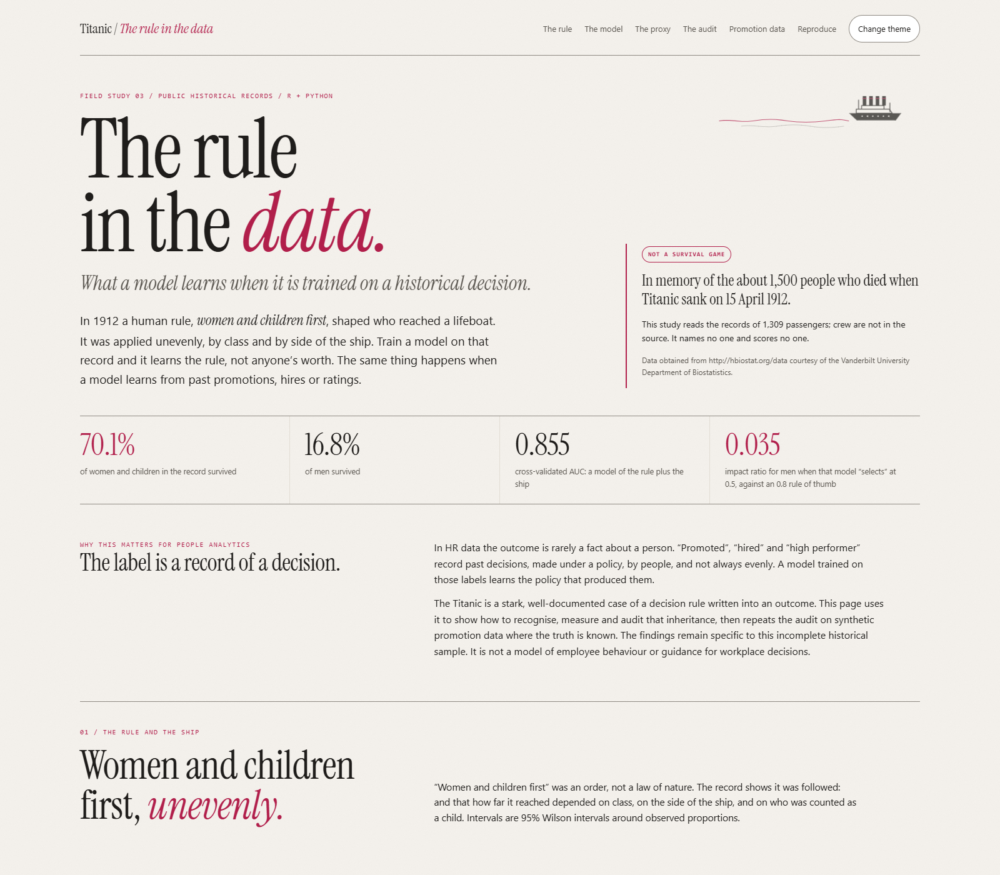

# Titanic / Patterns in the Record

### What prediction can—and cannot—tell us

The Titanic disaster claimed around 1,500 lives on 15 April 1912.

**Predicting an outcome is not explaining it.** This historical observational
study separates descriptive patterns, predictive performance and uncertainty.
It does not identify a policy's effect or explain why any individual survived
or died.

**A real, public-data case study in R and Python.** It covers 1,309 titanic3
passengers, uses repeated grouped cross-validation, and compares group-level
diagnostics. A **separate synthetic promotion example** explores selected audit
methods under specified assumptions, including deliberately introduced
disparities. It is not evidence about real employees or organizations.



**[Explore the interactive story](https://mbc81.github.io/titanic-patterns/)** ·
**[Start in R](R/README.md)** · **[Python edition](Python/README.md)** ·
**[Methodology](METHODOLOGY.md)** · **[Data guide](data/README.md)**

> The source excludes crew. Models produce record-level predictions for
> evaluation, not recommendations about people. Associations are not causes.

## Five findings

| # | Question | What the evidence shows |
|---|---|---|
| 1 | **How do recorded groups differ?** | Women and children: 70% survived. Men: 17%. Among women and children, 97% survived in first class and 46% in third. These are descriptive comparisons, not policy-effect estimates. |
| 2 | **Who appears in the boat records?** | Among passengers with recorded boats, those classified as adult men made up **41%** on starboard and **12%** on port. Access, timing, missing ages and recording limit interpretation. |
| 3 | **How do feature sets compare?** | Demographic terms reach a cross-validated AUC of 0.79; structural terms reach 0.69; together, **0.85**. The random-forest difference has an interval spanning zero (95% CI −0.01 to 0.01), not evidence of equivalence. |
| 4 | **What information remains after removing sex?** | Without sex terms the model reproduces 14% of the observed sex gap. Add the passenger's **title** and it reproduces **98%**. Title recovers recorded sex with AUC 0.9999; this alone does not establish discrimination or a historical mechanism. |
| 5 | **What do group diagnostics reveal?** | The male-to-female predicted-positive rate ratio at 0.5 is 0.035. Observed rates and mean predictions are close within each sex group, yet false-positive rates differ: 0.57 for women vs 0.006 for men. Agreement in averages does not establish calibration across the probability range or fairness. |

### A separate synthetic promotion example

The synthetic simulation contains 5,000 employees and is clearly labelled as
synthetic. It injects a −0.70 log-odds penalty for women and a −0.50 penalty for
regional staff. Part-time status has **no** effect.

- **Simulated decisions:** promotion rates are 12.4% for women and 21.4% for
  men, an impact ratio of 0.58.
- **Penalties removed:** the rates become 23.2% vs 23.6%, an impact
  ratio of 0.98.
- **Gender-visible model:** it recovers the planted penalty, −0.68 with a 95% CI
  of −0.89 to −0.46.
- **Gender-blind model:** the predicted gap shrinks, but the model now
  penalises **part-time work** (−0.29, CI excludes 0), which had no true effect.
  The reason is that 29% of women and 4% of men in the simulation are part-time.

This illustrates one possible proxy failure mode under the chosen generating
process, not its prevalence in real workplaces.

## Find your way

| Your goal | Start here |
|---|---|
| See the visual story without installing anything | [Interactive story](https://mbc81.github.io/titanic-patterns/) |
| Run or read the R edition | [`R/`](R/) · [`titanic-patterns.Rproj`](titanic-patterns.Rproj) |
| Run or read the Python edition | [`Python/`](Python/) · [Executed notebook](notebooks/01_titanic_python.ipynb) |
| Understand where the data came from | [Data guide](data/README.md) · [Pinned provenance](data/provenance.json) |
| Inspect splits and repeated folds | [`data/split.csv`](data/split.csv) · [`data/repeated_cv.csv`](data/repeated_cv.csv) |
| Inspect the audit tables | [Python results](outputs/python/) · [R results](outputs/r/) |
| Check what was prespecified | [Analysis contract](METHODOLOGY.md) |

## What makes this more than a Titanic accuracy exercise

- **Feature comparisons.** Demographic, structural and combined models assess
  predictive information, not separate causal contributions. The exported
  "Policy" model labels are shorthand for demographic feature sets.
- **Honest uncertainty.** The models run 20 × 5 repeated cross-validation,
  grouped by shared ticket. Model differences use paired **Nadeau–Bengio**
  corrected intervals rather than one lucky split.
- **Multiple group diagnostics:**
  - impact ratios with Katz intervals;
  - agreement between group outcome rates and mean predictions;
  - TPR, FPR and PPV with Wilson intervals;
  - suppression of any cell with a denominator below 20.
- **A specified-process check.** The separate synthetic simulation tests the
  methods against deliberately introduced disparities.
- **Two languages, one answer.** R and Python share every split and fold, and a
  parity script checks that the Bayesian fits and audit tables agree. The random
  forests are deliberately excluded, because their implementations differ.
- **Careful data work:**
  - fare is divided by ticket size, because it was recorded per ticket;
  - the 891-row Kaggle sample is kept as a regression test;
  - no names, tickets, cabins or biographical text are committed.

The original analytical lenses remain in the interactive appendix. Select an
association rule to compare its confidence with the same outcome's training
baseline, with both denominators visible. Highlight a model across the held-out
scorecard, ROC and calibration views without hiding the alternatives or changing
the evaluation.

## Run it

Use the [R guide](R/README.md) or [Python guide](Python/README.md) to install
dependencies and run the analysis. Normal runs read the committed extract and
need no internet access or account.

```powershell
.\.venv\Scripts\python.exe -m Python.run_analysis      # about 90 s, includes the audit
.\.venv\Scripts\python.exe -m pytest tests -q
.\.venv\Scripts\python.exe scripts\check_parity.py     # after running the R edition
.\.venv\Scripts\python.exe scripts\build_story.py      # rebuild docs/index.html
```

R and Python write their results to `outputs/r/` and `outputs/python/` respectively.
The browser story is a single self-contained HTML file with no backend,
analytics, external fonts or CDN.

## Interpretation and responsible use

- This is an **observational** study of curated historical records. It covers
  passengers only, not crew. Ages are missing for 29% of third-class passengers
  and 6–12% of other classes, which is a data-quality gap that falls unevenly.
- The source records sex as a binary.
- Coefficients and rules describe associations within this record. They do not
  explain anyone's fate.
- Employment heuristics do not establish fairness in historical survival data.
  Formal calibration/error-rate trade-offs depend on their definitions and
  assumptions; group-average agreement is not a full calibration test.
- The simulation is synthetic by design. Its generating assumptions are known,
  but it does not establish performance in real organizations.
- Read the [full methodology](METHODOLOGY.md) before reusing any part of this.

## Repository map

```text
R/                       R edition: analysis, audit, tests, narrative
Python/                  Python reference: analysis.py, audit.py, figures, notebook builder
notebooks/               Executed Python notebook
data/                    titanic3 extract, splits, repeated folds, synthetic promotions, provenance
outputs/python, outputs/r Model scores, audit tables, intervals, figures
scripts/prepare_data.py  Recreate and checksum-check every data file
scripts/check_parity.py  Compare shared evidence across R and Python
scripts/build_story.py   Bundle result tables into the offline story
web/story.html           Authored story layout and interactions
docs/index.html          Generated standalone story (GitHub Pages)
METHODOLOGY.md           Prespecified features, models, audit rules and limits
```

## Data credit and licence

Data obtained from http://hbiostat.org/data courtesy of the Vanderbilt University
Department of Biostatistics. titanic3 was compiled by Thomas Cason from
Encyclopedia Titanica. The hbiostat terms state: "Permission is granted to anyone
wishing to use the data sets provided here." Upstream content is not necessarily
public domain, so this repository commits only the minimal fields listed in
[provenance](data/provenance.json). It contains no names or biographical text.

Historical context comes from the British Wreck Commissioner's Inquiry (1912):
1,178 lifeboat seats and about 711 people saved.

Application code and original documentation are released under the
[MIT licence](LICENSE). The generated story embeds the Instrument Serif font under
the SIL Open Font License (see `web/assets/`). All other dependencies keep their own licences.
